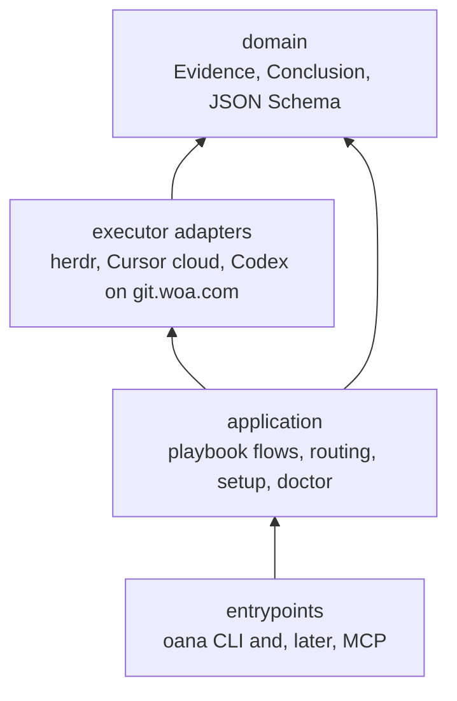
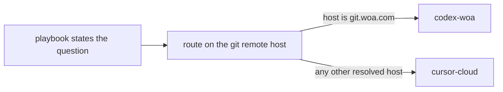
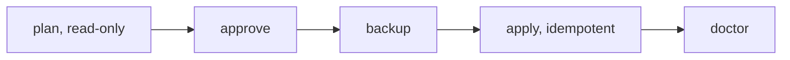

# oanastack architecture

Design only. Nothing in this document is implemented, and none of it authorizes a merge.

This note models oanastack on [REA](https://github.com/morluto/rea) at commit `ed084b3dbb13ec9dee1adc8f5b76e784b52c00bb` (`ed084b3`). REA is MIT, copyright 2026 morluto. The ideas adapted here are the inward layering, the Evidence record, question-shaped tools, generated catalogs, `setup` then `doctor`, restrained skills, and a CI split between real engines and agent tool-selection. oanastack does not vendor REA source. Playbooks, worktrees, herdr, and the progress dashboard stay oanastack's.

REA was read at that commit, not from memory:

- `AGENTS.md` — inward dependencies, Evidence provenance, setup that shows a plan and waits for approval, generated files that are not hand-edited.
- `docs/architecture.mermaid` — CLI and MCP as entrypoints over shared application flows.
- `docs/tool-design.md` — tool shapes, unknown coverage, paging, catalog completeness, real-engine lanes, tool-selection evals.
- `src/domain/evidence.ts` — zod Evidence: `ev_` id, provider, subject digest, locations, `observed` / `derived` / `inferred`, limitations, `evidence_links`.
- `src/application/Setup.ts`, `SetupPlan.ts`, `SetupClientConfiguration.ts` — discover, confirm, backup to `*.rea.backup`, then an idempotent write. A failed backup does not write.
- `src/application/Doctor.ts` — read-only checks with a classification and a remediation.
- `.agents/skills/reverse-engineer-anything/SKILL.md` and `references/evidence-workflows.md` — when not to run, first tool by target, summary first, finding ledger, close each question, page large results.
- `.agents/skills/rea-tool-design/SKILL.md` — design returns a boundary, a shape, Evidence semantics, the nearest alternative, and how to verify.
- `scripts/generate-mcp-tool-catalog.mjs` — the catalog is generated from contracts and checked, not trimmed to what one session can run.
- `docs/testing.md` and `.github/workflows/ci.yml` — reusable `real-*` workflows, plus `npm run verify:agent` for a real Codex CLI. A fake provider does not prove a real one.

## Where oanastack is now

`main` (`b0e34cd`) is a skill and bash CLI repo.

- Playbooks in `skills/oanastack/playbooks/` are step cards. Each ends in a prose **回复**. Babysit reports mode, frontier PR, `gh` state, what was fixed or rejected, what is left, and what a person must decide. Review reports intent, risk, test gaps, comments or LGTM, and what the author must decide. Those sentences are the first two typed bodies below.
- `bin/oana` maps aliases in `~/.config/oanastack/repos.toml`, then opens Worktrunk worktrees under `~/.local/state/oanastack/features`. One feature, one branch name, one worktree per repo. Session cwd is the worktree. Worktree isolation stays on `oana` / `wt`.
- Long and local coding sessions use `skills/herdr-grokbot/SKILL.md`. A cloud Grok bot drives a local Codex pane through [herdr](https://github.com/herdrdev/herdr), with the session cwd set to the feature worktree. Herdr's own statuses are `idle`, `working`, `blocked`, `done`, and `unknown`. This loop does not replace a Cursor cloud agent.
- `skills/agent-readiness-report/` already grades `pass`, `fail`, `unknown`, `blocked`, and `n/a`, and labels evidence `static`, `executed`, or `external`. Unknown stays visible.
- Install is manual `ln -s` from the README: skills into `~/.agents/skills` (Claude paths optional), `bin/oana` into `~/.local/bin`, and a copied `repos.toml`.

Pull request [#14](https://github.com/Oanakiaja/oanastack/pull/14), branch `cursor/progress-dashboard-2b01` at `d0c3985`, is not on `main`. It adds `packages/oanastack`: a TypeScript CLI, SQLite, and a localhost board. A dashboard feature lives under `~/.oanastack/projects/<project>/features/<feature>/`, one worktree per repo, with `.oanastack/` metadata. That plane is not the Worktrunk plane. Completions store `changed`, `why`, `verified`, `risks`, and `review` as text. Herdr status on a target is free text. `feature merge` stops at an open PR (or a local merge with `--local`). This design does not edit that package. When #14 lands, a completion may cite a `conclusion_id`; the two directory planes stay two planes.

## Layering

Dependencies point inward. Domain types do not import an executor, the CLI, or MCP. Adapters may depend on domain types. Application flows may depend on the executor port and on domain types. They do not import herdr's socket protocol, a Codex CLI transcript, a Cursor cloud client, or a git.woa.com client. Entrypoints call application flows and do not reimplement them.



An arrow means "depends on".

| Layer | Owns | Does not own |
| --- | --- | --- |
| Domain | Meaning of Evidence, conclusions, coverage, and routing facts (repo host, explicit override). Schema in `references/evidence.schema.json`. | Process spawn, HTTP, symlink writes, SQLite. |
| Executor adapters | One executor's protocol, normalized into Evidence. | Which playbook to run, whether the PR is merge-ready, which host wins. |
| Application | Playbook flows shared by the CLI and MCP. Routing. Setup plan and doctor. | Executor wire formats. Merge, land, and ship. |
| Entrypoints | `oana` argv, later MCP tool registration, exit codes. | A second copy of babysit or review. |

Long and local coding sessions go through `skills/herdr-grokbot/`. That skill is not the domain, and it is not where playbook conclusions are defined. The dashboard store, after #14, is also outside the domain: it can point at a conclusion, and it does not become the Evidence type.

Composition (a later wiring module) constructs adapters and passes them into application flows. Tests of a flow use a recording adapter. That recording adapter does not establish that Codex, herdr, Cursor, or git.woa.com behaved that way.

## 1. Evidence and conclusions

Every playbook returns one conclusion. The prose **回复** becomes `summary` plus a typed `normalized` body. Babysit and review have typed bodies in this draft. The other playbooks use `{ "kind": "deferred", "reply": "..." }` until a later PR types them. The shared schema is [`evidence.schema.json`](evidence.schema.json). Illustrations, not live reports, are in [`examples/babysit.conclusion.json`](examples/babysit.conclusion.json) and [`examples/review.conclusion.json`](examples/review.conclusion.json).

### Confidence

| Value | Use it when |
| --- | --- |
| `observed` | A forge, a command, or an executor returned this payload. Examples: `gh pr view`, a check conclusion, a test process exit code, a herdr status string. |
| `derived` | Computed from cited observations. Example: the same failure signature on two fetched logs, or `git merge-base --is-ancestor` over two observed oids. |
| `inferred` | A judgment the payload does not state. Example: "this looks like a flake" before a fresh build, or an LGTM rationale. |

Static analysis of a diff does not observe a test run. A herdr `unknown` status is observed unknown; it is not a derived failure.

### Coverage

`coverage.status` is `complete`, `partial`, or `uncovered`.

`uncovered` means the question is unknown. It does not mean the check failed, the file is missing, or the PR is blocked. The babysit example lists an `e2e` check with no conclusion: `forge_mergeable` is `unknown`, the conclusion status is `partial`, and `unknowns[]` holds the open question. A review that saw no test file in the changed-path list has observed that gap. A review that did not run tests does not report that those tests failed.

`n/a` in the readiness rubric is a scoped exclusion, recorded as a limitation, not as an uncovered fact and not as a pass.

### Identity

Ids are semantic hashes, not random uuids. Canonical form for the fixtures in this PR is compact UTF-8 JSON with lexicographically sorted object keys (RFC 8785 for these ASCII documents; the implementation PR owns a real JCS library and re-checks the fixtures).

Subject digest: SHA-256 of `{kind, locator}` plus `git_oid` when the subject has one. `name` is display only.

Evidence id: `ev_` plus SHA-256 of the projection `{provider, subject.kind, subject.digest, subject.git_oid?, operation, parameters, raw_result, normalized_result, confidence, authority, limitations, locations, evidence_links, coverage}`. Excluded: `evidence_id`, `subject.name`, `subject.locator`, and `page`. The page is a retrieval hint so it can name its own id without a cycle. Links to other Evidence stay inside the hash.

Conclusion id: `cn_` plus SHA-256 of `{playbook, question, status, summary, what_was_done, evidence_ids, unknowns, needs_human, normalized}`. The conclusion hashes Evidence ids, not the whole records.

### Locations, links, and pages

Locations are pull request, commit, CI check, file, command, or log page. Limitations are a required array; an empty array means the producer asserted none, not that the field was forgotten.

`evidence_links` cite other `ev_` ids. A derived claim links the observations it used. An unknown may link the Evidence that shows the hole.

Large results are not pasted into the conclusion. CI logs and full diffs use `page`:

- `detail: "summary"` and `complete: false` mean the inline `normalized_result` is the summary.
- A later `inspect_evidence` (catalog PR) reads one page by `parent_evidence_id` and `cursor`.
- The producer is not run again to refill a truncated chat preview.

### Babysit body

Matches today's reply, and stops where the playbook stops.

- `mode`: `drive`, `check`, or `threads-only`.
- `frontier`: repository, number, url, `forge_mergeable` (`mergeable`, `blocked`, or `unknown`), head oid or null.
- `actions[]`: `fixed`, `rejected`, or `reported`, each with a reason.
- `remaining[]`: still open.
- `stopped_before_merge`: the schema pins this to `true`.

Ready follows the forge. A green-looking subset of checks is not `mergeable` when the forge was not asked or a named check has no conclusion.

### Review body

- `intent_aligned`: `true`, `false`, or `"unknown"` when the intent was not established.
- `risks`, `test_gaps`, `comments` (`nit` flag).
- `verdict`: `lgtm`, `lgtm_with_reservations`, `changes_requested`, or `unresolved`.

Review does not push, rebase, or retry CI. Those actions belong to babysit, and babysit still does not merge.

### Other playbooks

Until they grow typed bodies, `research`, `feat`, `bugfix`, `test`, `cicd`, `cleanup`, `reflect`, and `readiness` still have to fill the envelope: question, status `answered` / `partial` / `unresolved`, summary, what was done, Evidence, unknowns, and `needs_human`. `normalized` is `{ "kind": "deferred", "reply" }` carrying today's prose reply. Readiness keeps its eight-pillar rubric; the envelope cites the same pass / fail / unknown / blocked / n/a rows as Evidence instead of replacing the scale.

Dashboard completions stay text until a follow-up after #14. The intended projection is: `changed` and `why` from the summary, `verified` citing Evidence ids, `risks` from unknowns and limitations, `review` from the review verdict. Herdr's raw status string can remain beside that citation.

## 2. Executors

A playbook states the question and the evidence it needs. It does not name Codex, herdr, Cursor, or git.woa.com. Routing selects an executor. The executor returns Evidence about the run (status, cwd, prompt digest, limitations). The application flow, not the adapter, builds the conclusion.

```ts
// Draft only. Not compiled in this PR.

type ExecutorId = "herdr" | "cursor-cloud" | "codex-woa";

interface RepoRouteFacts {
  /** From `git remote get-url`, not from the alias in repos.toml. */
  remoteUrl: string | null;
  host: string | null;
}

interface ExecutorTask {
  playbook: string;
  question: string;
  repo: { alias: string | null; remoteUrl: string; worktree: string };
  /** What to do, taken from the playbook. No executor name. */
  prompt: string;
}

interface ExecutorHealth {
  id: ExecutorId;
  available: boolean;
  version: string | null;
  limitation: string | null;
}

interface Executor {
  readonly id: ExecutorId;
  inspect(): Promise<ExecutorHealth>;
  run(task: ExecutorTask): Promise<{
    status: "finished" | "blocked" | "failed" | "cancelled";
    evidence: Evidence[];
  }>;
}

type RouteDecision =
  | { executor: "codex-woa" | "cursor-cloud"; reason: "repo-host"; host: string }
  | { executor: ExecutorId; reason: "caller-override"; host: string | null }
  | { executor: null; reason: "unresolved-host" };
```



Rules:

1. An explicit caller override is the whole decision, including `herdr`. Record it as observed (the caller said so) on the run's parameters.
2. Otherwise, if the remote host is `git.woa.com` or a subdomain, select `codex-woa`. In the routing sentence, "Codex" means this adapter.
3. Otherwise, if a host was resolved, select `cursor-cloud`.
4. If the remote URL cannot be read, the decision is `unresolved-host`. Stop and ask. Do not guess `cursor-cloud`.
5. `herdr` is not inferred from the host. A worktree on the laptop does not by itself select it. It needs a machine the caller already chose: an approved remote shell plus a herdr pane (`skills/herdr-grokbot/SKILL.md`). Session cwd is the feature worktree. Worktree isolation stays on `oana` / `wt`.

| Id | Today | Adapter notes |
| --- | --- | --- |
| `herdr` | `skills/herdr-grokbot/SKILL.md` | Long and local coding sessions. Record herdr's status string as observed. Do not invent a second enum. Webhook URLs and Authorization stay in `~/.config/herdr/grokbot-webhook.env`. Session cwd is the feature worktree. |
| `cursor-cloud` | Not in the repo | Cursor cloud agent. No in-repo client on current main. |
| `codex-woa` | Not in the repo | Codex on git.woa.com. Internal remotes only. No protocol is specified here. |

## 3. `oana setup` and `oana doctor`

These replace the README's manual `ln -s`. Until the implementation PR lands, the README links are still the install path.

Setup is a transaction: plan, approve, backup, apply. Doctor is read-only and is safe to run before any apply. The same order REA uses: discover without writing, show the plan, require approval, backup, then an idempotent write. Setup does not install Node, npm, Homebrew, Worktrunk, herdr, Codex, the GitHub CLI, or Java. Those stay bring-your-own. A missing tool is a doctor finding.



### Links

Default plan, sources relative to the oanastack checkout:

| Source in the checkout | Destination |
| --- | --- |
| `skills/oanastack` | `~/.agents/skills/oanastack` |
| `skills/herdr-grokbot` | `~/.agents/skills/herdr-grokbot` |
| `skills/agent-readiness-report` | `~/.agents/skills/agent-readiness-report` |
| `bin/oana` | `~/.local/bin/oana` |

Opt-in with a client flag, because the README marks them optional:

| Source | Destination |
| --- | --- |
| `skills/oanastack` | `~/.claude/skills/oanastack` |
| `skills/agent-readiness-report` | `~/.claude/skills/agent-readiness-report` |
| `~/.claude/commands/agent-readiness-report.md` (that `~` is a directory name in this repo) | `~/.claude/commands/agent-readiness-report.md` |

When `bin/oanastack` exists in the checkout (the dashboard branch), the plan also links it to `~/.local/bin/oanastack`. On current `main` that source is absent, so the action is omitted rather than reported as a failure.

`repos.toml` is a copy, not a symlink. If `~/.config/oanastack/repos.toml` is missing, the plan copies `.config/oanastack/repos.example.toml`. If the file exists, the action is a no-op even when it differs from the example. Setup never refreshes user paths.

Creating `~/.agents/skills` or `~/.local/bin` is its own `mkdir` action in the plan.

### Plan, backup, apply

```ts
// Draft only.

type SetupEffect = "create" | "retarget" | "noop";

interface SetupAction {
  id: string;
  kind: "symlink" | "copy-if-absent" | "mkdir";
  source: string | null;
  destination: string;
  effect: SetupEffect;
  backupPath: string | null;
}

interface SetupPlan {
  /** SHA-256 of the canonical action list. apply rejects a different tree. */
  digest: string;
  actions: SetupAction[];
  doctor: DoctorReport;
}
```

- A destination that is already the correct symlink is `noop`. No backup, no write.
- A destination that exists and is not that symlink is `retarget`. Backup by renaming the inode to `destination.oana.backup`. Renaming keeps a symlink as a symlink and does not copy the skill tree it points at.
- If `destination.oana.backup` already exists, fail closed. Do not overwrite the backup, and do not write the new link.
- If the backup rename fails, do not write.
- After a write, read the link back. A mismatch leaves the backup in place and reports `needs_human`.
- A second apply of the same plan performs no writes.
- Non-interactive `oana setup` prints the plan and exits without writing. Apply takes the plan digest the user approved.

### Doctor

Doctor does not create, retarget, or delete anything.

```ts
// Draft only.

type DoctorClass =
  | "healthy"
  | "missing_link"
  | "broken_symlink"
  | "config_drift"
  | "missing_dependency"
  | "missing_path";

interface DoctorCheck {
  name: string;
  ok: boolean;
  classification: DoctorClass;
  detail: string | null;
  remediation: string | null;
  evidence: Evidence;
}
```

Checks:

- Each managed symlink resolves. A dangling link is `broken_symlink`, which is not the same class as `missing_link`.
- A link that resolves somewhere other than this checkout is `config_drift`.
- A regular file or directory sitting where a symlink should be is `config_drift`. Doctor does not delete it.
- `repos.toml` present, and each alias path exists. A missing path is `missing_path`. Doctor does not create the directory.
- `git`, `gh`, `wt`, and `node` on `PATH` when a flow needs them. Absence is `missing_dependency` plus the install hint from the README. Doctor does not install them.
- Herdr, Codex, and the Cursor cloud client are inspected only when that executor is in scope. A machine that never uses herdr is healthy without it.
- Dashboard scope is informational until #14 is on `main`: report whether `bin/oanastack` and `~/.oanastack` exist, and do not fail the default scope for their absence.

Each failed check includes a remediation a person or a later agent can follow ("run `oana setup` and approve the retarget", "install worktrunk", "fix the alias path"). The check's Evidence uses `operation: "oana doctor"`, confidence `observed`, and a file or command location. Doctor is not a playbook conclusion.

## Catalog and CI

Later PRs, specified now so the shape does not drift.

The tool catalog is generated from the contracts, the way REA generates `scripts/generate-mcp-tool-catalog.mjs` output. The script registers every contract and writes the advertised input and output schemas. CI fails if the committed catalog drifts. The catalog lists every tool even when an executor or a session cannot run it. Availability is a field on the call result, not a missing row. Catalog order never selects which tool runs.

CI has three lanes:

1. **Fast lane.** Schema validation, domain id vectors (the two examples in this directory), playbook flows against a recording adapter. No network.
2. **Real-executor lane.** One scenario per executor that is actually configured: herdr when its socket is up, Cursor cloud when its credentials are present, Codex on git.woa.com only on a runner that can reach that host. A fake adapter does not pass this lane. Skip with a named reason when the executor is not configured; do not mark the scenario passed.
3. **Agent tool-selection evals.** A real host agent, disposable config, scenarios that name the expected first tool. Include a negative case whose expected first tool is null (the user said "this PR" and did not give a repository). Record host, model, catalog digest, selected tools, arguments, errors, retries, and whether the task's claims matched the Evidence. Keyword overlap in the final prose does not pass the lane.

## Optional next steps

Not in this PR. The shapes below are what the later PRs should implement.

### MCP

Three tools, executor-neutral, each returning a conclusion:

| Tool | Question | Shape | Calls |
| --- | --- | --- | --- |
| `start_feature` | Open the worktrees for this feature. | `workflow` | Application feature flow. Uses `oana feature` / Worktrunk on the local plane. Does not create a dashboard workspace unless the caller asked for that plane. |
| `check_pr` | Is this frontier PR merge-ready? | `workflow` | Babysit in `check` mode. Reads the forge. Does not merge. |
| `readiness_report` | How ready is this repo for a coding agent? | `workflow` | The existing eight-pillar rubric. Returns findings. Does not apply fixes. |

`inspect_evidence` is the paging read for a retained `ev_` id. It is a fourth tool only if callers otherwise paste logs back into the prompt.

### Skill template

The later skill rewrite replaces the "read every card" opening with this shape. Long steps stay in `skills/oanastack/playbooks/` and `skills/oanastack/references/`. This directory (`references/` at the repo root) stays the architecture notes.

```markdown
---
name: oanastack
description: Route oanastack playbooks and return a conclusion with evidence. Use for research, a multi-repo feature, a bugfix, tests, review, babysitting a PR, CI triage, worktree cleanup, or a retro. Skip for a merge, a production config edit, or a herdr Codex pane.
---

# oanastack

Skip this skill when the user is merging or shipping, editing production
configuration, or driving a long or local coding session through herdr
(`skills/herdr-grokbot/SKILL.md`). Installing the skill does
not register MCP and does not run setup. If the tools are already listed,
use them. Run doctor only for a broken link or a missing command you hit.

## Pick the first tool from the goal

- Merge-ready, CI, or review threads on a PR: `check_pr`. Mode `check` unless
  the user asked to drive the PR to merge-ready.
- Comments on a diff, no CI push: the review playbook, not `check_pr`.
- Start a multi-repo feature: `start_feature`, then work in the worktree cwd.
- Agent readiness: `readiness_report`. Do not fix findings in that turn.
- No repository, number, or path: ask. Do not pick a nearby checkout.

## Work summary-first

Read the conclusion summary and its inline Evidence. Follow a page reference
only when the summary leaves a specific question open. Do not re-run the
producer to refill a truncated preview.

Keep a finding ledger: each item has a status (`answered`, `partial`,
`unresolved`), Evidence ids, confidence, and unknowns. Before finishing,
close every item on the original list. Uncovered is unknown. Do not describe
the investigation as done while a required item is open.

## Details

Playbook steps stay in `skills/oanastack/playbooks/`. Copy the matched card
into the todo list. Architecture and the Evidence schema are under
`references/` at the repo root.
```

### Tool-design checklist

Adapted from REA's `docs/tool-design.md` for oanastack questions. Use it when adding an MCP or CLI operation.

1. Start from the question. "Is this PR merge-ready?", "Does this diff match its intent?", "What failed in CI?", "Is this repo ready for an agent?".
2. Extend a tool when the question and the result contract match. Add one when the outcome or the authority differs. Review and babysit stay separate. Babysit and merge stay separate.
3. Public names do not include an executor. The result reports which executor ran, with coverage.
4. Keep the catalog complete. Report unavailable executors on the result.
5. Pick a shape:
   - `inspect` — one PR, one target, one readiness pillar, one symlink.
   - `search` / `list` — candidate PRs, failing checks, feature worktrees. Stable order. Page when the forge pages.
   - `trace` — review thread to commit to CI job, with unresolved hops kept.
   - `compare` — two oids, base versus head, previous readiness report versus this one. Static difference is not a cause.
   - `workflow` — a repeated outcome: babysit check, review, start feature, readiness. Inline summary, contributing Evidence, partial facets.
   - `observe` — an executor run or a herdr pane. Authority, lifecycle, and cleanup. Observing a session does not widen its cwd or its approval mode.
6. Strict inputs. Required identity (repository and number, or path). Drop flags the handler ignores.
7. Return Evidence inline: provider, subject digest, locations, confidence, limitations, links. Uncovered coverage is an unknown, with an id.
8. Keep observed, derived, and inferred distinct. A provider that omits a field leaves it unknown; it does not force every executor to invent the same metadata.
9. Add a limit only for a real constraint: forge page size, log bytes, process timeout. An assumed chat budget is not a reason to drop checks. Say when the result is paged, truncated, or partial.
10. Protocols and parsers live in adapters. The flow that turns observations into a conclusion lives in the application layer and is what the CLI and MCP both call.
11. When discovery changes, run the tool-selection evals. Schema validity is not a successful selection.

## Later PRs

Implementation is a sequence of small PRs. This one does not start them.

1. **Domain package.** JSON Schema, a zod mirror, and id functions. Unit tests are the two examples in `references/examples/`. No I/O.
2. **Babysit and review flows.** Pure functions from already-fetched forge and command observations to a conclusion. Recording fixtures only.
3. **Executor port and routing.** The decision table above, plus a fake adapter. No network.
4. **`herdr` adapter.** Herdr status strings stay observed. Do not parse pane text into a private status list. Long and local coding sessions use `skills/herdr-grokbot/SKILL.md`. Worktree isolation stays on `oana` / `wt`.
5. **`cursor-cloud` adapter.** No client is in the repo. Add one here. Do not add a second local coding CLI.
6. **`codex-woa` adapter.** git.woa.com only, behind the host rule.
7. **`oana setup` and `oana doctor`.** Then update the README so the `ln -s` blocks point at setup.
8. **Remaining playbook bodies.** Replace `deferred` for feat, bugfix, test, cicd, research, cleanup, reflect, and readiness.
9. **Catalog generator and MCP.** `start_feature`, `check_pr`, `readiness_report`, and `inspect_evidence` if paging needs a tool. CI checks the generated catalog.
10. **Skill rewrite.** Apply the template. Leave step cards where they are.
11. **CI lanes.** Fast, real-executor, and agent tool-selection.
12. **Dashboard citation.** After #14 merges: completions may store a `conclusion_id`. Do not merge the Worktrunk plane with `~/.oanastack` workspaces.

## Credit

REA — Reverse Engineer Anything — <https://github.com/morluto/rea>, MIT License, copyright 2026 morluto. Reference commit `ed084b3dbb13ec9dee1adc8f5b76e784b52c00bb`.

The MIT license requires its copyright and permission notice on substantial copies of the software. This repository does not copy REA source. The notice lives in REA's `LICENSE`. What this design reuses is the structure described in the opening section, restated for playbooks, pull requests, CI, tests, and the executors oanastack already has.

## Non-goals

- No runtime, no package, no CLI flag, and no MCP server in this change.
- No merge of this PR, and no merge behavior added to babysit.
- No change to `packages/oanastack` while it lives only on the dashboard branch.
- No Graphite, and no production config writes.
- No install of unrelated software inside setup.
