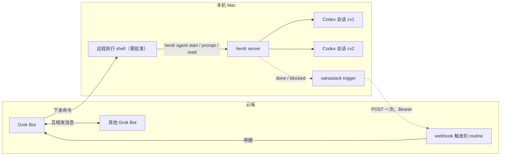

# herdr grokbot

云端 Grok Bot 通过本机 [herdr](https://github.com/herdrdev/herdr) 驱动 Codex 或 Claude。Agent 以 dangerously yolo 模式启动，并自动 attach `oanastack trigger`。完成或卡住时，本地 trigger 服务把最后输出 POST 一次给 webhook routine，再唤醒 Grok Bot。灵感 [@turingou](https://x.com/turingou/status/2108386640658038954)。

herdr 是 Rust 写的、面向编程 agent 的终端复用器。文档 <https://herdr.dev/docs>。server 托管 pane，识别 agent 状态 `idle` / `working` / `blocked` / `done` / `unknown`。控制面是 CLI，本地 unix socket `~/.config/herdr/herdr.sock`（每行一个 JSON）。没有 HTTP API，不会主动发 webhook。

动手前先跑 `herdr --skill`，读当前二进制自带的官方 agent 指南。已安装的 `herdr` 是命令语法的权威。官方指南假定调用方在 pane 内（`HERDR_ENV=1`）。本 recipe 是云端 Bot 经用户批准的远程 shell 调本机 CLI，不在 pane 里，因此没有 `HERDR_ENV`。

实测：herdr 0.8.2、codex-cli 0.153、macOS。

## 架构



循环：Grok Bot 发 prompt → Codex 或 Claude 干活 → `done` / `blocked` → trigger POST 一次 → routine 唤醒 Grok Bot → 决定继续、转给别的 Bot，或告诉用户。

## 不要

- 每次远程 shell 都要用户批准。
- pane id 从 JSON 取（`workspace create` 的 `.result.root_pane.pane_id`，例如 `w9:p1`）。不要猜，不要按侧边栏顺序推。
- 批准框先 `agent read` 看命令，确认安全再 `send-keys … y`。
- 批准框之外不要往输入框发字符。输错用 `ctrl+u` 清行。
- 模型不被账号支持时用 `-m` 覆盖，不改用户的 `~/.codex/config.toml`。
- webhook URL 和 Authorization 只放 `~/.config/herdr/grokbot-webhook.env`，不要贴进聊天。
- 本机 `oana grokc` 会话和 Cursor Cloud Agent 走各自的 skill，不用这条回路替代。

## 搭建

1. 安装：

```bash
curl -fsSL https://herdr.dev/install.sh | sh
herdr integration install codex   # 可选
```

2. 常驻 server。直接 `herdr server &` 会随启动它的 shell 退出而死：

```bash
launchctl submit -l dev.herdr.server -o /tmp/herdr-server.log -e /tmp/herdr-server.log -- ~/.local/bin/herdr server
herdr agent list
```

3. 建工作区。pane id 取 `.result.root_pane.pane_id`：

```bash
herdr workspace create --cwd <dir> --label <x> --no-focus
```

4. 启动 Codex 或 Claude。用 `oanastack trigger start`，不要手写 herdr 参数。两者都会加上 dangerously yolo，并在后台 attach trigger。没有 `oanastack trigger serve` 时 `start` 会自己拉起。codex 0.153 没有 `--full-auto`。若 `~/.codex/config.toml` 里的 model 不被 ChatGPT 账号支持（400 model not supported），把 `-m` 放在 `--` 后面：

```bash
oanastack trigger start cx1 --kind codex --pane <pane>
oanastack trigger start cl1 --kind claude --pane <pane>
```

这会执行 `herdr agent start <agent> --kind <kind> --pane <pane> -- <yolo flag>`。Codex 的 flag 是 `--dangerously-bypass-approvals-and-sandbox`，Claude 的是 `--dangerously-skip-permissions`。还要追加原生参数时放在 `--` 后面，例如 `-- -m gpt-5.5`。不要改用户的 `~/.codex/config.toml`。

agent 名须匹配 `[a-z][a-z0-9_-]{0,31}`，且在存活 agent 中唯一。`agent start` 要的是已有的空闲 shell pane，不会自己建 pane。

5. 新目录首次会弹 trust 提示：`start` 返回 `agent_not_ready`（blocked）。名字仍可用于 `read` / `send-keys`。键名用大写 `Enter`，小写 `enter` 无效：

```bash
herdr agent send-keys cx1 Enter
```

6. 发任务。`--wait` 等到第一次落到 `done` 或 `blocked`（也会落到 `idle`）。超时单位毫秒：

```bash
herdr agent prompt cx1 "..." --wait --timeout 600000
herdr agent read cx1 --source recent-unwrapped --lines 60
```

7. yolo 模式下工具批准框不应出现。若仍是 `blocked`，先 read：trust 提示用 `Enter`，提问确认安全后再送键。不要对没读过的屏幕送 `y`：

```bash
herdr agent send-keys cx1 y
```

紧接着的 `herdr agent wait cx1` 会立刻返回旧的 `blocked`（当前状态已经匹配，wait 不会等它变化）。sleep 几秒，再用 `herdr agent get cx1` 轮询 `.result.agent.agent_status`。

## 状态

状态靠读屏幕，可能停在 `unknown`。`unknown` 只说明分不了类，不能当成完成。

- `idle`：可以输入，且该 tab 已在聚焦的 herdr UI 里看过。
- `done`：后台工作结束、UI 还没看过，底层与 `idle` 相同。在 UI 里看过该 tab 之后变成 `idle`。CLI read 不会把它标成已看。
- `blocked`：批准框或提问。
- `working`：正在跑。

CLI 错误是 stderr 上的 JSON，退出码 1。

## 回调

Grok Bot 建一个 webhook 触发的 routine。用户从 routine 面板复制 Webhook URL 和 Authorization header，写到 `~/.oanastack/grokbot-webhook.env` 或 `~/.config/herdr/grokbot-webhook.env`：

```bash
GROKBOT_WEBHOOK=…
GROKBOT_AUTH=…
```

本机先跑 trigger 服务，再让每个 agent 自动 attach。`trigger serve` 会盯着 `herdr agent list`，新出现的 codex / claude 都会挂上 watcher。`trigger start` 在启动时再显式 attach 一次。

```bash
oanastack trigger serve
oanastack trigger doctor
```

也可以只盯一个 agent（参数是 agent 名，默认 `cx1`）。仓库里的 `skills/herdr-grokbot/scripts/grokbot-notify.sh` 现在转给 `oanastack trigger attach`，不再自己 POST webhook：

```bash
skills/herdr-grokbot/scripts/grokbot-notify.sh cx1
```

watcher 把 `{agent, kind, status, summary, text, cwd, worktree, branch, ts}` 交给 `http://127.0.0.1:4748`。`branch` 来自该 cwd / worktree 的 `git rev-parse --abbrev-ref HEAD`，worktree 根来自 `git rev-parse --show-toplevel`。`oanastack trigger status` 列出每个 session 的 branch、cwd、worktree。服务去重后，只在 `done` / `blocked` 时用 `Authorization: Bearer` POST 一次到 `GROKBOT_WEBHOOK`，正文里同样带这三项。失败重试，并追加到 `~/.oanastack/trigger.log`。同一次停驻不会发第二次；状态离开 `done` / `blocked` 之后再进来，才会再发。

进度看板（PR #14）还没接这条字段。每日工作先读 webhook 和 `trigger status --json`。看板和 worktree map 上按 session 显示 branch 是后续。

herdr 不会主动 webhook，所以这条回路用轮询。下面三项还没在这条回路上验证：

- webhook 实际 POST 能唤醒 routine
- 用插件事件 `pane.agent_status_changed` 代替轮询（socket 文档有这个订阅名；插件钩子未测）
- Codex 自带 notify / Stop hook 作为替代

## 已验证

Grok Bot 远程驱动 Codex 端到端：建工作区 → 启动 → prompt → 批准 `git add` → `done`。Codex 做了零依赖 Node todo CLI，5 个测试通过并 commit。

回调链路未验证。
